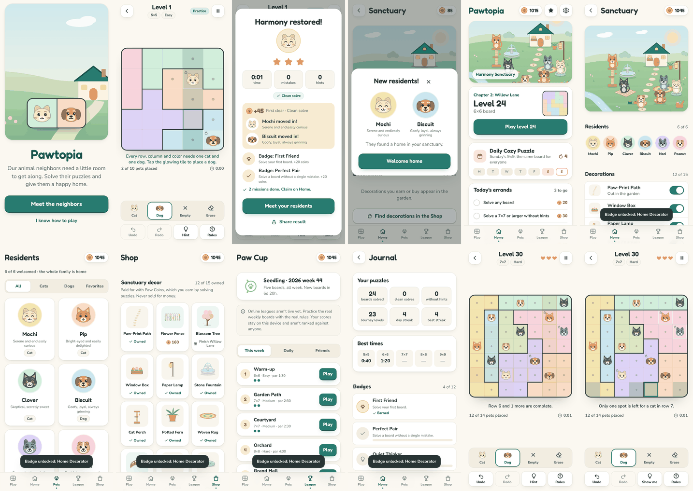

# Pawtopia

*A clever little puzzle with a whole lot of heart.*

Pawtopia is a cozy, portrait-first logic puzzle for iPhone. For the first 20 levels every row, column and color region
needs exactly **one animal**, and animals never touch, not even at a corner. From level 21 each line holds **two
animals**, one of each kind, never side by side. Every board has one answer you can reach by logic alone. Pick a tool
under the board (the animal, ✕ or Erase) and tap a tile; one tap places the animal.

Every puzzle you solve builds a sanctuary: the Farm first (a sheep, a piglet, a calf, a goat kid, a chick, a pony),
then the Pet Garden's bunny, cats and dogs, then the Outback, Savanna, Arctic and Amazon as the Journey opens them.
Animals come home one at a time, and the board shows the one you're bringing home. The animals on the board are alive
in the smallest way: they blink, glance, smile and frown, but only their faces move.



Built with Vite + TypeScript (no UI framework) and shipped to iOS with Capacitor. It grew out of Cats vs Dogs v1; the
puzzle engine, its tests and every v1 board are preserved, and v1 saves migrate automatically.

## What's in the game

| | |
| --- | --- |
| **Journey** | Levels 1–20 are verified one-animal boards (5×5 → 9×9); level 21 teaches two animals, and from there the verified two-animal boards follow, then endless generated boards. Stars for clean, hint-free solves; a decoration gift per chapter. |
| **First run** | A two-sentence welcome, then a forgiving guided board with Cotton the sheep where the deduction engine highlights forced moves one at a time. Level 21 is a guided two-animal lesson. |
| **Daily Cozy Puzzle** | One shared board per day (one animal until you've reached two), with a gentle streak and one free Cozy Day per month. |
| **Zen Garden** | Any size, no clock, no hearts. |
| **Paw Cup** | Five fixed two-animal boards per UTC week, two attempts each, no hints, best counts. Opens after level 21. |
| **Sanctuaries** | The Farm and the Pet Garden from the start, four regions later. Each grows with every puzzle you solve, with its own animals, treats and decorations; animals ride the tire swing, the tractor, the balloon. 3D soft toys. |
| **Animals** | 27 original animals with personalities that shape their expressions, collected sanctuary by sanctuary in the Animal album. |
| **Meta** | Free Paw Coins on an idempotent ledger, 3 daily missions + 1 weekly, 12 badges, a Journal of stats. |
| **Comfort** | Tap / double-tap or classic tap-cycle controls, left-handed layout, reduced motion, high contrast, region patterns, large board mode, VoiceOver labels, offline play, no sign-in. |

## Run it

```bash
npm install
npm run dev        # http://localhost:5173 (open the LAN URL on your phone)
npm test           # 357 unit tests: engines, session, storage, faces, economy, world, scoring, verifier
npm run gen:check  # generates 1,000 puzzles and verifies uniqueness / validity
npm run pack:check # re-verifies the 60-level launch pack
npm run build      # typecheck + production build → dist/
npm run e2e        # browser smoke test against `npm run dev` (needs Playwright, see test/e2e/smoke.mjs)
```

In development builds, Settings → Developer → *Expression gallery* shows every pet in every mood with live tiles.

## Ship it to iOS

Needs a Mac with Xcode and an Apple Developer account.

```bash
npm run build
npx cap add ios          # once; creates ios/App
npx cap sync             # copies dist/ into the native shell
npx cap open ios         # opens Xcode
```

The bundle id stays `com.sam3lds.catsvsdogs` so Pawtopia ships as an update to the existing app (see
`docs/DECISIONS.md` D9). Before TestFlight, work through `docs/release-checklist.md`.

## Project layout

```
src/engine/        puzzle engines: two-animal (unchanged from v1: solver, deduction, generator, levels, rng), one-animal (solo.ts)
src/data/          frozen, verified Journey packs + pack format/verification
src/game/          session (marks, hearts, undo/redo, hints, snapshots, event log), modes, dates, persistence
src/meta/          progression, rewards, ledger, sanctuary, missions, achievements, onboarding, catalogs
src/competitions/  scoring formula, replay verifier, league rules, weekly cup boards, local practice cup
src/services/      storage (v2 + migration), kv guard, ads/iap adapters, analytics, audio, haptics
src/ui/            router + screen lifecycle, screens, components, art (pet rigs, sanctuary), face animation
src/config/        feature flags, economy tuning
test/              unit tests (vitest) + e2e smoke (playwright)
docs/              roadmap, decisions, architecture, design system, assets, privacy, backend plan, release checklist
```

## Honest by design

- Paw Coins are earned only by playing and buy only cosmetics. Nothing random, nothing pay-to-win.
- Release builds can't buy anything or show an ad until a real, verified store / ad network is integrated.
- League scores are labeled practice and never ranked against anyone until server verification exists.
  No made-up players, ever.
- No account, no sign-in, no analytics sent. Everything stays on the device.

See `docs/PAWTOPIA_ROADMAP.md` for status and the steps that need you (Apple, StoreKit, Firebase).
